# 1. Portada

## Universidad Tecnológica de San Luis Río Colorado
### BIS (Bilingual, International, Sustainable)
### {idgs} UNCODING THE FUTURE

**Materia:** Extracción de Conocimiento en Base de Datos  
**Docente:** Prof. Julia Elizabeth García Herrera  
**Evaluación:** Evaluación – Tercer Unidad  

**Integrantes:**
- Jesus Rodolfo Lopez Gamez
- Josue Misraim Valenzuela Verdugo
- Axel Alan Jimenez Jaramillo

**Grupo:** IDGS 9 - 3  
**Fecha:** 24 / Noviembre / 2026  
**Repositorio GitHub:** `[PEGAR AQUÍ EL ENLACE AL REPOSITORIO PÚBLICO DE GITHUB]`

---

# 2. Introducción y planteamiento del problema

## Introducción

Las empresas de venta al menudeo acumulan información de miles de clientes, pero suelen tratarlos a todos por igual: la misma promoción, el mismo mensaje y el mismo canal. Esto desperdicia presupuesto de marketing en clientes que no responden y descuida a quienes generan la mayor parte del ingreso.

La **segmentación de clientes** agrupa a personas con un comportamiento de compra parecido para atender a cada grupo con una estrategia distinta. En este proyecto se aplica el algoritmo de aprendizaje no supervisado **K-Means** sobre tres variables del modelo **RFM**:

- **Recencia (R):** días desde la última compra.
- **Frecuencia (F):** número de compras en los últimos 12 meses.
- **Monto (M):** gasto total en los últimos 12 meses.

Los resultados se presentan en un **dashboard interactivo desarrollado con Streamlit**.

## Planteamiento del problema

La empresa no sabe:

1. Qué clientes generan la mayor parte del ingreso y deben protegerse.
2. Qué clientes dejaron de comprar y están en riesgo de abandono.
3. Qué clientes compran poco y podrían crecer con la promoción adecuada.

Sin esa información, las campañas de retención y promoción se diseñan "a ciegas". **Pregunta guía:** *¿Qué grupos de comportamiento de compra existen entre los clientes según su recencia, frecuencia y gasto, y qué estrategia conviene aplicar a cada uno?*

---

# 3. Objetivos

## Objetivo general

Segmentar a los clientes con el algoritmo K-Means usando sus variables de recencia, frecuencia y gasto, para identificar grupos de comportamiento de compra y proponer estrategias de retención y promoción basadas en datos, presentadas en un dashboard interactivo.

## Objetivos específicos

1. Explorar el dataset para identificar su estructura, tipos de datos, valores nulos, duplicados y atípicos.
2. Limpiar y preprocesar los datos (inconsistencias, nulos, duplicados, tipos, atípicos y codificación) y escalar las variables con `StandardScaler`.
3. Determinar el número óptimo de clústeres evaluando al menos 5 valores de K con el método del codo y el coeficiente de silhouette.
4. Entrenar el modelo final, interpretar sus centroides y asignar un nombre descriptivo a cada clúster.
5. Comparar dos configuraciones del modelo y explicar sus diferencias.
6. Desarrollar un dashboard en Streamlit con indicadores, filtros y visualizaciones de los resultados.
7. Redactar hallazgos, recomendaciones y limitaciones del modelo.

---

# 4. Descripción del dataset

| Característica | Valor |
|---|---|
| Archivo crudo | `data/raw/clientes_segmentacion.csv` |
| Origen | Dataset sintético generado con `src/generar_dataset.py` (semilla fija `np.random.seed(42)`) |
| Registros crudos | **915** (900 clientes + 15 filas duplicadas) |
| Variables | **10** |
| Registros después de la limpieza | **900** |
| Archivo final | `data/processed/clientes_segmentados.csv` (incluye `cluster` y `cluster_nombre`) |

## Diccionario de variables

| Variable | Tipo | Descripción |
|---|---|---|
| `id_cliente` | Texto | Identificador único del cliente (CLI-0001…) |
| `edad` | Numérica | Edad del cliente en años |
| `genero` | Categórica | Masculino / Femenino |
| `region` | Categórica | Norte, Centro, Sur, Occidente |
| `canal_preferido` | Categórica | Online, App móvil, Tienda física |
| `antiguedad_meses` | Numérica | Meses desde su registro como cliente |
| `frecuencia_compras` | Numérica | Compras en los últimos 12 meses **(F)** |
| `gasto_total` | Numérica | Gasto en MXN en los últimos 12 meses **(M)** |
| `recencia_dias` | Numérica | Días desde la última compra **(R)** |
| `satisfaccion` | Numérica ordinal | Calificación de 1 a 5 de la última encuesta |
| `ticket_promedio` | Numérica (derivada) | `gasto_total / frecuencia_compras` (se crea en la limpieza) |

## Problemas de calidad detectados en el dataset crudo

| Problema | Cantidad |
|---|---|
| Celdas nulas (edad, gasto, recencia, canal, satisfacción, región) | 97 |
| Filas duplicadas exactas | 15 |
| Montos de gasto guardados como texto (`"$12,345.50"`) | 12 |
| Categorías inconsistentes (`online`, `ONLINE`, `App movil`, `M`, `FEMENINO`…) | 142 valores |
| Edades imposibles (150 años o 2 años) | 7 |
| Recencias negativas / frecuencia igual a 0 | 3 / 3 |
| Gastos extremos por error de captura | 6 inyectados (9 recortados por la regla) |

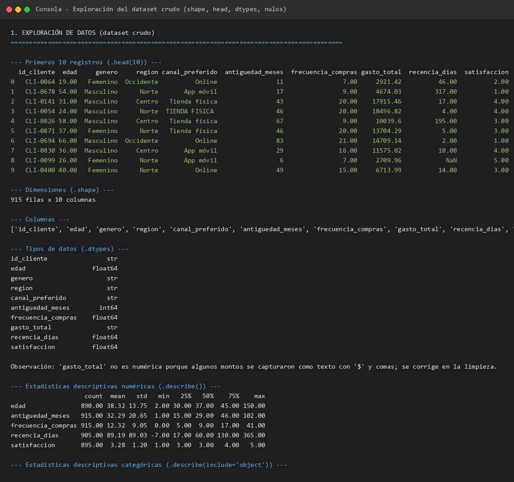

---

# 5. Desarrollo del proyecto

## 5.1 Herramientas

Python 3.12, Pandas, NumPy, Scikit-learn, Matplotlib, Seaborn, Plotly y Streamlit. El proyecto se organizó en scripts modulares:

| Script | Función |
|---|---|
| `src/generar_dataset.py` | Genera el dataset crudo con errores intencionales |
| `src/analisis_kmeans.py` | Exploración, limpieza, escalado, selección de K, modelo y comparación |
| `src/interpretacion.py` | Nombres de clústeres, estadísticas, hallazgos y recomendaciones |
| `src/main.py` | Ejecuta todo el pipeline y guarda resultados |
| `app.py` | Dashboard interactivo de Streamlit |

## 5.2 Exploración de datos

Se cargó el CSV con `pd.read_csv()` y se revisaron los primeros 10 registros, dimensiones, columnas, tipos de datos, estadísticas descriptivas, nulos y duplicados. Se detectó que `gasto_total` se leía como texto por los montos con `$`, y que las categorías tenían múltiples escrituras para un mismo valor.

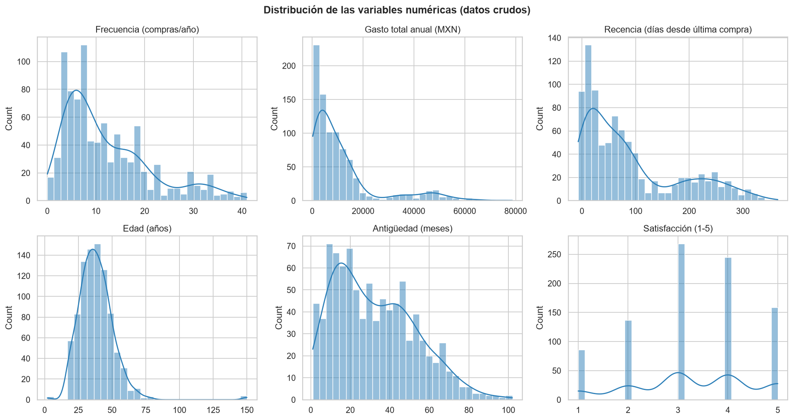

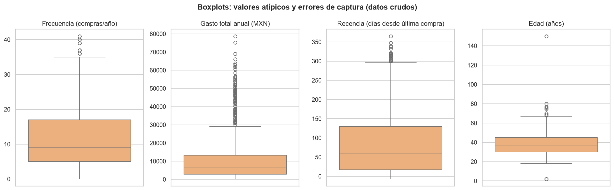

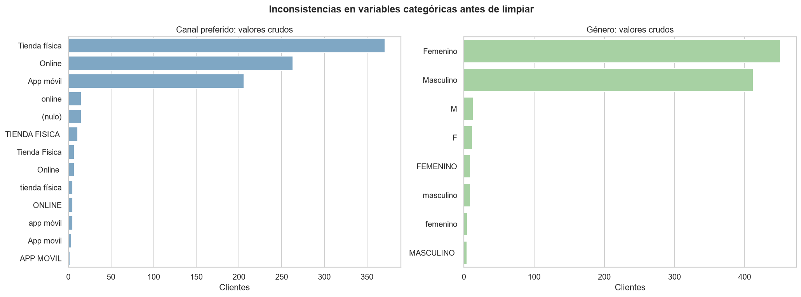

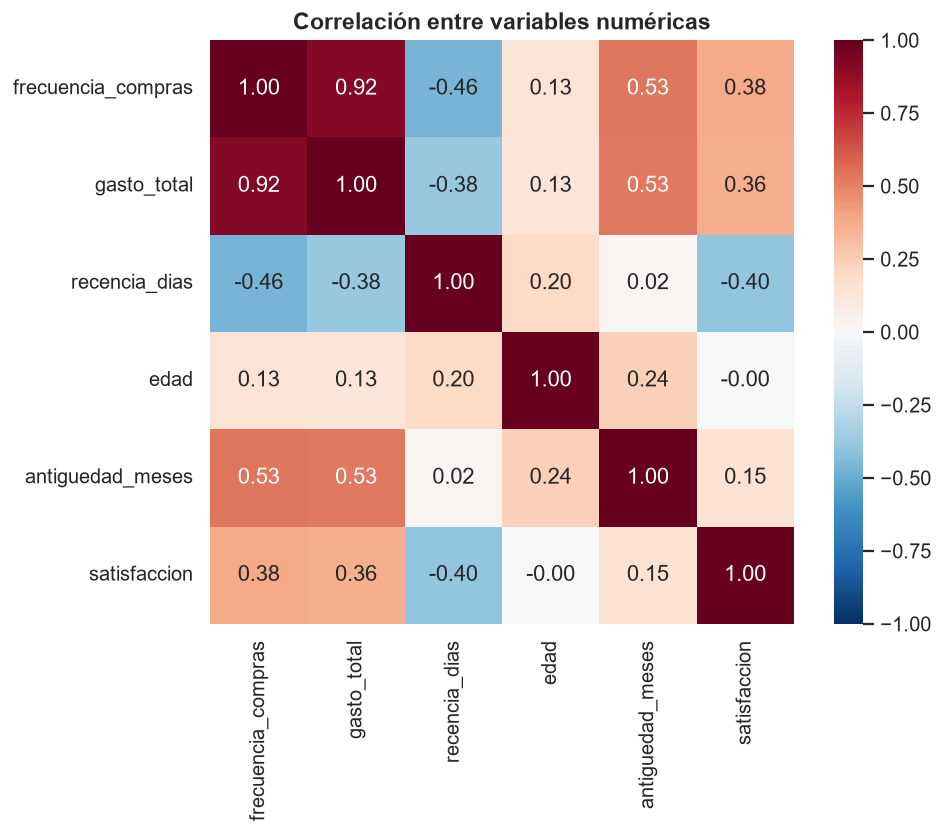

**Variables seleccionadas para agrupar y justificación:**

- **`recencia_dias` (R):** mide qué tan activo está el cliente; es el mejor indicador temprano de abandono.
- **`frecuencia_compras` (F):** mide el hábito y la lealtad.
- **`gasto_total` (M):** mide el valor económico del cliente.

Las tres responden directamente a la problemática, son numéricas continuas (adecuadas para la distancia euclidiana de K-Means) y no son redundantes. `ticket_promedio` se descartó por ser una combinación de gasto y frecuencia; edad, satisfacción y las variables categóricas se reservaron para describir y validar los clústeres.

## 5.3 Limpieza y preprocesamiento

| Paso | Acción | Registros afectados |
|---|---|---|
| Inconsistencias | Unificar `canal_preferido`, `genero` y `region` (espacios, mayúsculas, acentos, abreviaturas) | 60 + 52 + 30 |
| Tipos de datos | Convertir `gasto_total` de texto a número | 12 |
| Duplicados | Eliminar filas idénticas | 15 |
| Valores inválidos | Edad fuera de 18–90, recencia negativa y frecuencia 0 se marcan como nulos | 7 + 3 + 3 |
| Nulos numéricos | Imputación con la **mediana** (robusta a atípicos) | 86 |
| Nulos categóricos | Imputación con la **moda** | 23 |
| Atípicos | Detección con IQR (1.5×) y recorte (*capping*) solo de los valores que superan la cerca extrema 3×IQR **y** el percentil 99 | 9 (gasto) |
| Variable derivada | `ticket_promedio = gasto_total / frecuencia_compras` | 900 |
| Codificación | One-Hot Encoding de `genero`, `region`, `canal_preferido` → `data/processed/clientes_limpios_codificados.csv` | 9 columnas nuevas |

**Criterio para atípicos:** la regla clásica de Tukey (1.5×IQR) marcó 107 gastos como atípicos, pero la mayoría son clientes de alto valor legítimos. Eliminarlos borraría justamente al segmento más importante, por lo que solo se recortaron los 9 valores extremos que correspondían a errores de captura y no se eliminó ningún cliente.

**Codificación:** las variables categóricas codificadas no entran a K-Means porque mezclar columnas 0/1 con variables continuas distorsiona la distancia euclidiana; se usan para describir el perfil de cada clúster.

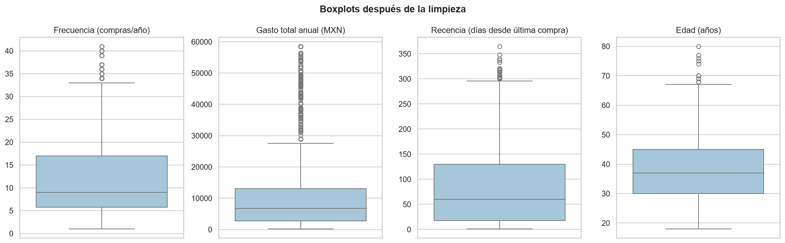

### Escalado con StandardScaler

| Variable | Media original | Desv. original | Media escalada | Desv. escalada |
|---|---|---|---|---|
| frecuencia_compras | 12.40 | 9.05 | 0.00 | 1.00 |
| gasto_total | 11,468.00 | 13,461.19 | 0.00 | 1.00 |
| recencia_dias | 89.11 | 88.50 | 0.00 | 1.00 |

**Explicación:** antes de escalar, la desviación estándar del gasto era unas **1,487 veces** la de la frecuencia; como K-Means se basa en distancias, el gasto habría dominado por completo el agrupamiento. `StandardScaler` aplica `z = (x − media) / desviación`, dejando las tres variables con media 0 y desviación 1, de modo que pesan lo mismo.

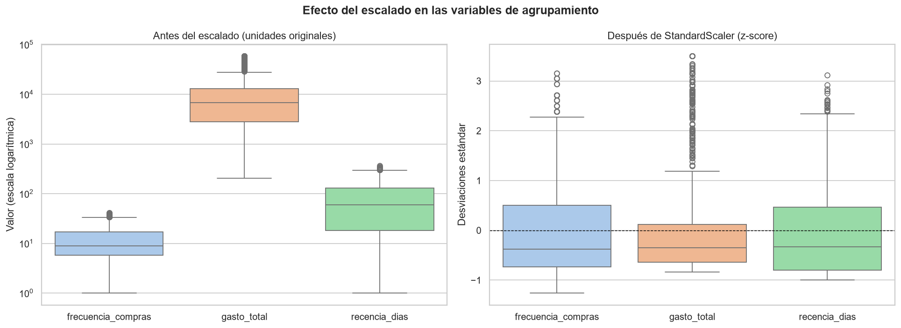

## 5.4 Implementación de K-Means

Se evaluaron **7 valores de K (2 a 8)** con `KMeans(n_init=10, random_state=42)`:

| K | Inercia | Silhouette | Davies-Bouldin |
|---|---|---|---|
| 2 | 1,318.04 | 0.581 | 0.560 |
| 3 | 665.75 | 0.528 | 0.630 |
| **4** | **310.00** | **0.585** | **0.516** |
| 5 | 267.77 | 0.529 | 0.733 |
| 6 | 228.18 | 0.501 | 0.815 |
| 7 | 192.61 | 0.437 | 0.898 |
| 8 | 174.31 | 0.344 | 1.011 |

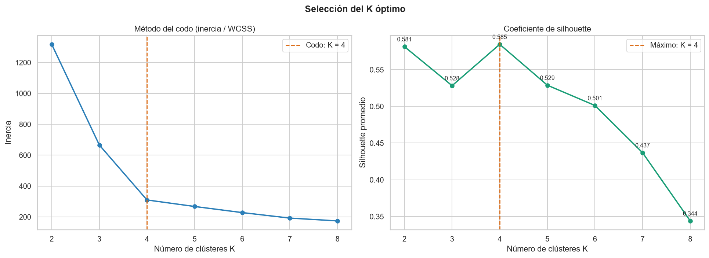

**Justificación del K óptimo = 4:**

Se compararon minuciosamente los resultados entre las diferentes opciones de K:
- Aunque **K = 2** presenta un coeficiente de silhouette alto (0.581), **K = 4** alcanza el máximo global de silhouette (**0.585**), el menor índice Davies-Bouldin (**0.516** frente a 0.560 en K=2) y un índice Calinski-Harabasz de **2,302.6** (frente a 941.5 en K=2, más del doble).
- En cuanto a la inercia (WCSS), de K=3 a K=4 se reduce un **53.4 %**, marcando el "codo" de la curva; a partir de K=4, aumentar a K=5 apenas reduce la inercia en un **13.6 %**, lo que indica rendimientos decrecientes.
- Desde la perspectiva de negocio y la metodología RFM, K=2 es metodológicamente insuficiente, pues divide los datos en dos mitades genéricas (activos vs. inactivos o alto vs. bajo gasto) sin poder distinguir a los clientes VIP de los regulares ni a los clientes en riesgo de los ocasionales. **K = 4** proporciona cuatro segmentos nítidamente diferenciados, interpretables y con estrategias de retención y crecimiento bien definidas.

El modelo final se entrenó con `fit_predict()` y K=4 (convergió en 4 iteraciones).

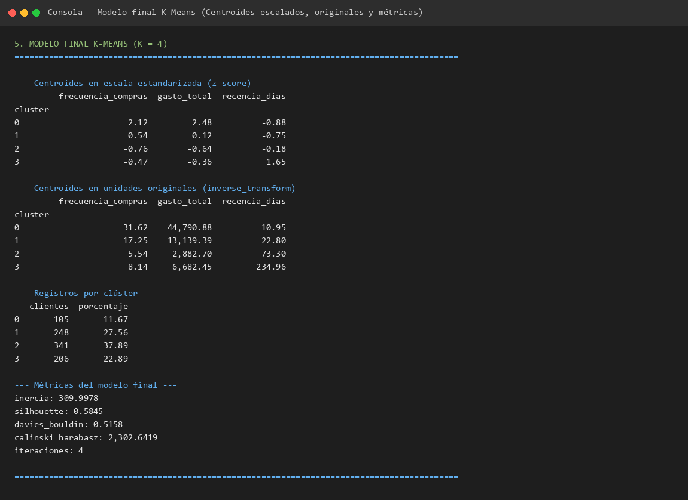

---

# 6. Resultados y análisis

## 6.1 Centroides e interpretación

| Clúster | Frecuencia (compras/año) | Gasto anual (MXN) | Recencia (días) | z-score F / M / R | Lectura |
|---|---|---|---|---|---|
| C0 | 31.6 | 44,791 | 11 | +2.12 / +2.48 / −0.88 | Compra mucho, gasta mucho y está activo |
| C1 | 17.3 | 13,139 | 23 | +0.54 / +0.12 / −0.75 | Compra seguido con gasto intermedio |
| C2 | 5.5 | 2,883 | 73 | −0.76 / −0.64 / −0.18 | Compra poco y gasta poco |
| C3 | 8.1 | 6,682 | 235 | −0.47 / −0.36 / +1.65 | Lleva casi 8 meses sin comprar |

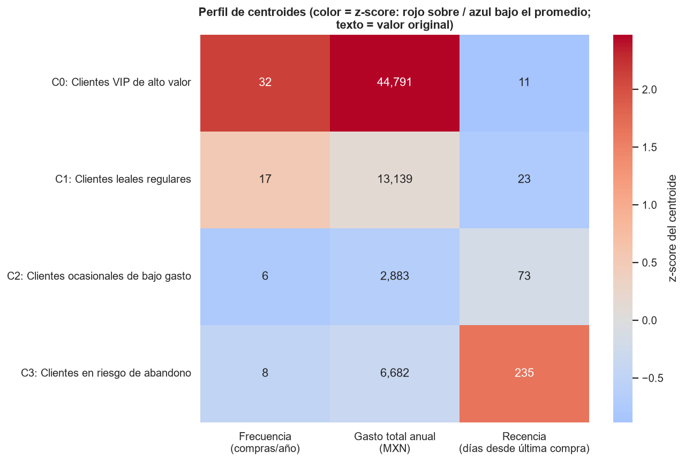

## 6.2 Registros por clúster y nombres descriptivos

| Clúster | Nombre descriptivo | Clientes | % clientes | % del gasto total |
|---|---|---|---|---|
| C0 | **Clientes VIP de alto valor** | 105 | 11.7 % | 45.6 % |
| C1 | **Clientes leales regulares** | 248 | 27.6 % | 31.6 % |
| C2 | **Clientes ocasionales de bajo gasto** | 341 | 37.9 % | 9.5 % |
| C3 | **Clientes en riesgo de abandono** | 206 | 22.9 % | 13.3 % |

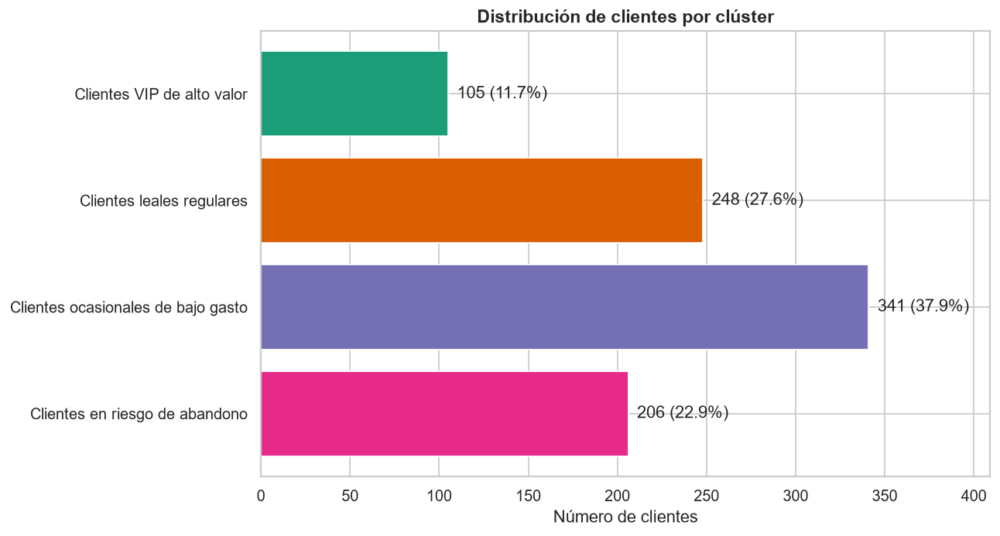

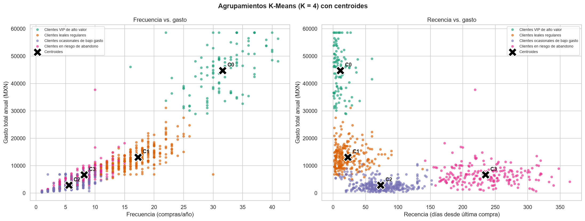

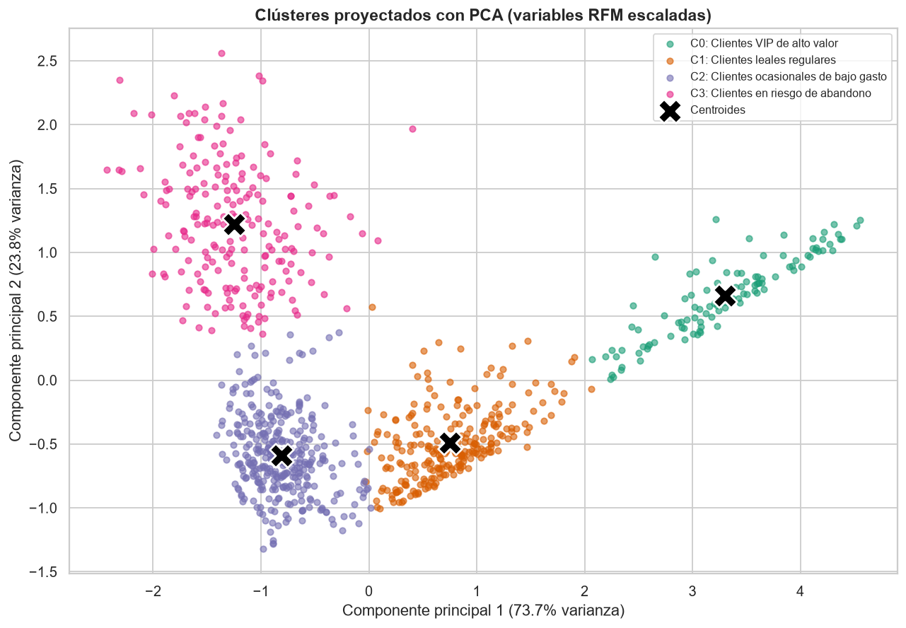

## 6.3 Tabla comparativa (estadísticas descriptivas por clúster)

| Indicador | VIP | Leales regulares | Ocasionales | En riesgo |
|---|---|---|---|---|
| Frecuencia media | 31.6 | 17.3 | 5.5 | 8.1 |
| Gasto medio (MXN) | 44,791 | 13,139 | 2,883 | 6,682 |
| Gasto mediano (MXN) | 45,956 | 12,455 | 2,439 | 6,234 |
| Recencia media (días) | 11 | 23 | 73 | 235 |
| Ticket promedio (MXN) | 1,432 | 761 | 517 | 811 |
| Edad media | 41.9 | 38.1 | 32.3 | 44.9 |
| Antigüedad media (meses) | 58.0 | 36.0 | 17.1 | 40.5 |
| Satisfacción media (1-5) | 4.34 | 3.63 | 3.11 | 2.57 |
| Canal principal | App móvil (43 %) | Online (40 %) | Tienda física (56 %) | Tienda física (51 %) |

La tabla completa con `describe()` por clúster está en `outputs/tables/estadisticas_por_cluster.csv`.

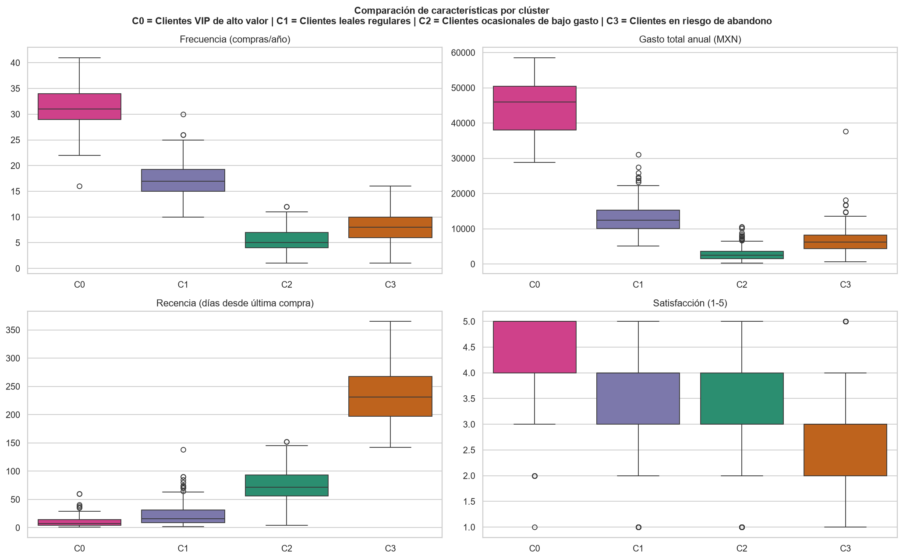

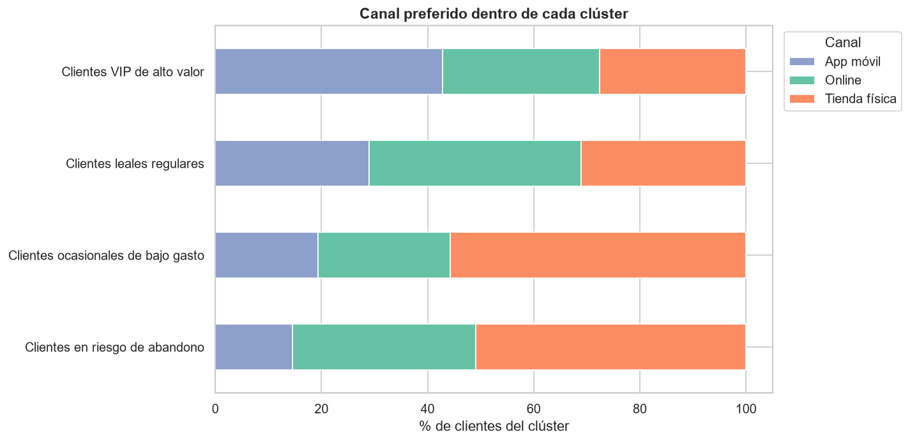

## 6.4 Similitudes y diferencias

- Los grupos **más parecidos** son *Leales regulares* y *Ocasionales* (distancia entre centroides = 1.61 en z-score): ambos están activos y se diferencian sobre todo en cuánto compran.
- Los **más diferentes** son *VIP* y *En riesgo* (distancia = 4.60): opuestos en las tres variables.
- *En riesgo* y *Ocasionales* tienen gasto y frecuencia bajos, pero los separa la recencia (235 vs. 73 días).
- *En riesgo* tiene un ticket promedio (811 MXN) similar al de *Leales* (761 MXN): fueron buenos clientes que dejaron de comprar.

## 6.5 Comparación de dos configuraciones del modelo

| Configuración | K | Escalado | Silhouette | Davies-Bouldin | Clúster más chico | Clúster más grande | Coincidencia con A (ARI) |
|---|---|---|---|---|---|---|---|
| **A) Modelo final** | 4 | Sí | **0.585** | **0.516** | 105 | 341 | 1.000 |
| B) Un clúster menos | 3 | Sí | 0.528 | 0.630 | 116 | 572 | 0.56 |
| C) Sin escalar | 4 | No | 0.352 | 1.08 | 47 | 510 | 0.51 |

**Nota metodológica sobre el espacio de cálculo:**
Las métricas de Silhouette y Davies-Bouldin de todas las configuraciones (incluyendo la opción sin escalar C) se calcularon rigurosamente en el **espacio estandarizado (z-score)** de las variables RFM. Esto garantiza una comparación matemática justa bajo una misma métrica geométrica. Si la configuración C se evaluara en su espacio original sin normalizar, las distancias euclidianas reflejarían casi en un 100 % las diferencias en pesos del gasto total (desviación estándar de 13,461 MXN frente a 9.05 en frecuencia y 88.5 días en recencia), distorsionando el análisis y ocultando que el algoritmo ignoró la recencia y la frecuencia en la delimitación de los clústeres.

- **A vs. B (cambiar K):** con K=3 el silhouette baja de 0.585 a 0.528 y se **fusionan** *Leales regulares* con *Ocasionales* en un grupo masivo de 572 clientes. Mezclar clientes que compran 17 veces al año con otros que compran 5 impide diseñar estrategias comerciales específicas.
- **A vs. C (con/sin tratamiento de escala):** sin `StandardScaler` el gasto domina la distancia: el segmento VIP **se parte en dos** solo por monto y los clientes *En riesgo* **se mezclan** con los *Ocasionales*, porque la recencia deja de influir. Al evaluar en el espacio estandarizado común, la coincidencia cae a ARI = 0.51 y el silhouette baja a 0.352. Esto demuestra que el escalado es indispensable para la segmentación RFM.

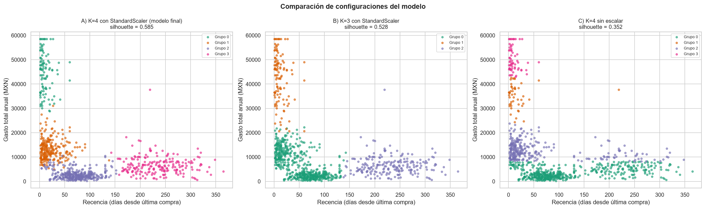

---

# 7. Dashboard

El dashboard se ejecuta con `streamlit run app.py` y tiene **dos páginas** seleccionables desde la barra lateral. Los filtros aplican a ambas páginas.

**Filtros interactivos (4):** clúster, canal preferido, rango de gasto anual y rango de frecuencia de compra.

## Página 1: Análisis general

- **4 KPI:** clientes analizados, gasto total acumulado, frecuencia promedio y recencia promedio (con comparación contra el total).
- Histograma con boxplot de la variable seleccionada, gráfica de dona por canal, barras por región y canal, mapa de correlación y dispersión frecuencia-gasto.
- Tabla de estadísticas descriptivas, vista de registros con descarga en CSV y resumen de la limpieza.

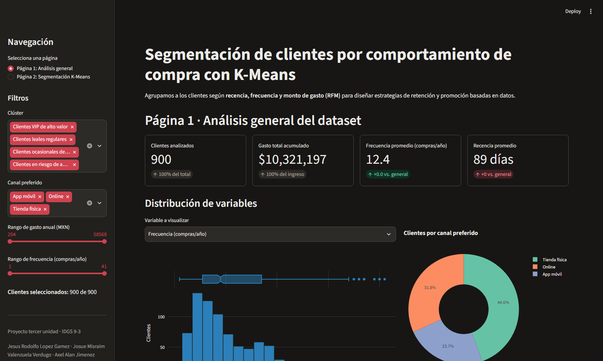

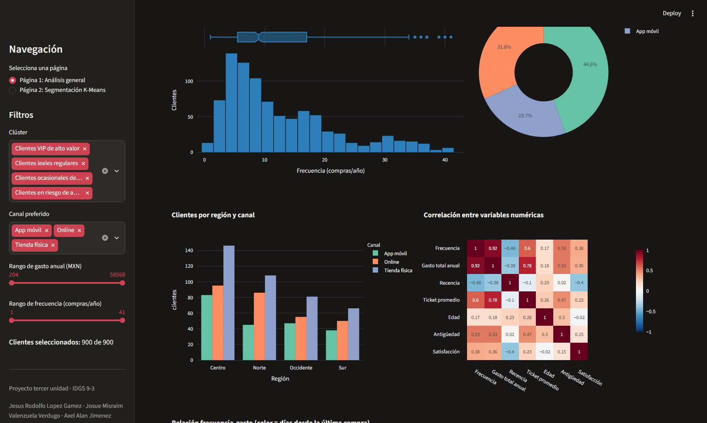

## Página 2: Segmentación mediante K-Means

- **4 KPI:** K óptimo con silhouette, segmento más numeroso, % del gasto generado por VIP y clientes en riesgo.
- **Distribución de registros por clúster** (barras).
- **Dispersión** 2D con centroides claramente identificados del modelo completo (ejes seleccionables) y vista 3D RFM.
- **Gráficas comparativas:** boxplot por clúster de la variable elegida, perfil promedio por clúster (índice 100 = promedio) y canal preferido por clúster.
- **Tabla de estadísticas descriptivas** de los clústeres.
- Resultados del modelo: codo, silhouette, métricas, centroides y comparación de configuraciones.
- **Descripción de los grupos** con su nombre descriptivo.
- **Hallazgos, recomendaciones** y limitaciones.

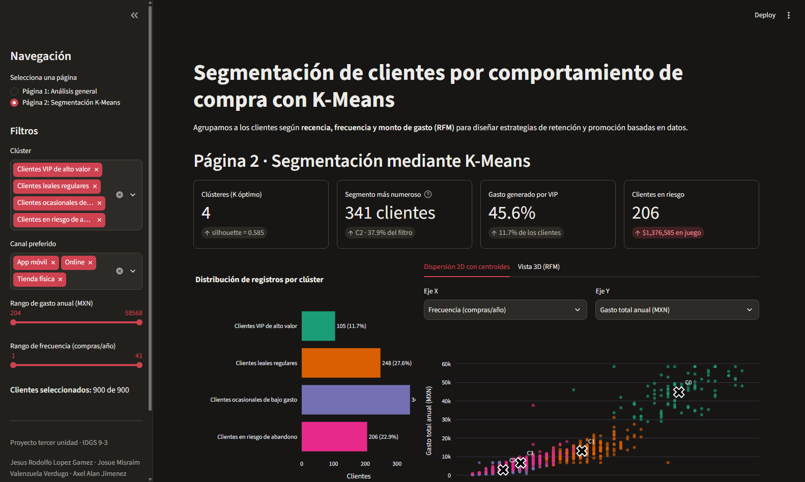

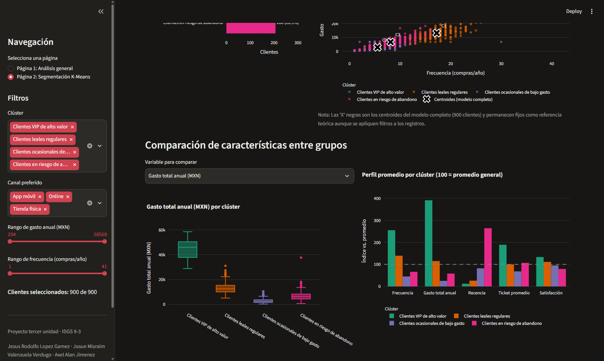

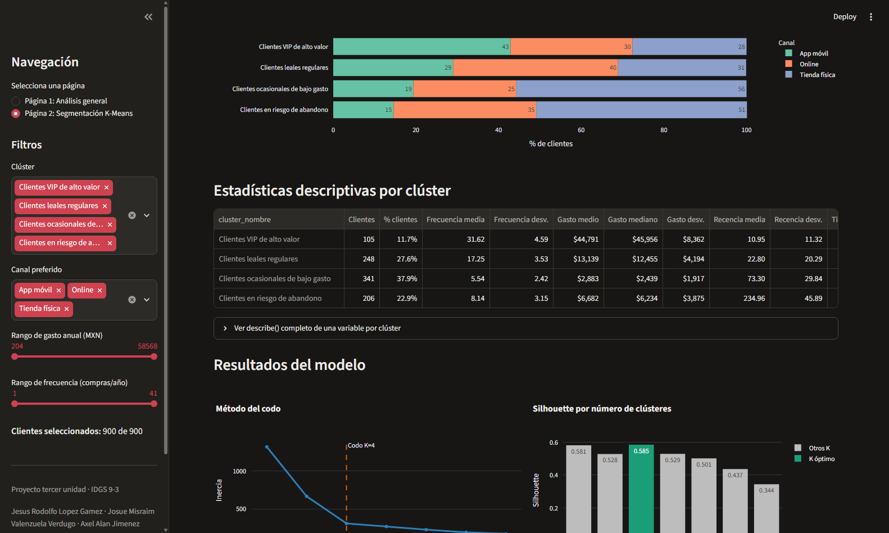

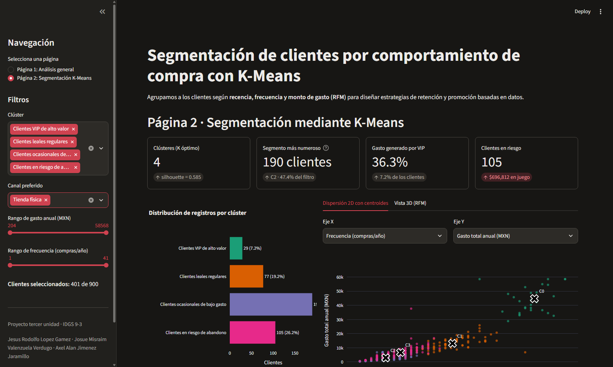

---

# 8. Conclusiones y recomendaciones

## Hallazgos principales

1. **Se identificaron 4 segmentos bien diferenciados** (silhouette = 0.585); el codo, el silhouette y Davies-Bouldin coinciden en K = 4.
2. **El valor está muy concentrado:** los *Clientes VIP* son solo el 11.7 % de la base, pero aportan el **45.6 % del gasto total** (44,791 MXN anuales por cliente en promedio).
3. **Hay ingreso en riesgo:** el 22.9 % de los clientes no compra desde hace 235 días en promedio (21 veces más que los VIP) y su gasto suma **1,376,585 MXN** (13.3 % del total).
4. **La base más grande es la de menor valor:** los *Ocasionales* son el 37.9 % de los clientes pero solo generan el 9.5 % del gasto; prefieren la tienda física.
5. **Caracterización complementaria mediante satisfacción:** al tratarse de un dataset sintético con perfiles latentes, la satisfacción no constituye una validación externa independiente, sino una variable descriptiva complementaria muy valiosa: la satisfacción promedio es **4.34/5** en clientes VIP frente a solo **2.57/5** en clientes *En riesgo*, reforzando cualitativamente que el abandono en compras se asocia a una menor experiencia percibida.

## Recomendaciones

1. **VIP – Retener:** programa de lealtad premium (acceso anticipado, envío gratis, atención prioritaria y beneficios exclusivos en la App móvil, su canal preferido). Perder a un cliente de este segmento representa perder ~$44,791 MXN al año.
2. **Leales regulares – Hacer crecer:** ventas cruzadas, paquetes y metas de puntos para subir su ticket (hoy $761 MXN) y convertirlos en VIP.
3. **Ocasionales – Activar:** cupón de segunda compra, recordatorios personalizados en tienda física y contenido de bienvenida para aumentar su frecuencia (5.5 compras/año).
4. **En riesgo – Reactivar:** campaña *win-back* con descuento por tiempo limitado, encuesta de satisfacción (promedio 2.57/5) y alertas automáticas a los 60 y 90 días sin compra.
5. **General:** recalcular la segmentación cada mes y medir la migración de clientes entre segmentos como KPI clave de retención.

## Limitaciones del modelo

- **Dataset sintético:** el dataset fue generado con distribuciones latentes y semilla fija 42; los resultados ilustran rigurosamente la metodología de segmentación RFM, pero deben validarse con datos reales de transacciones antes de implementar decisiones comerciales definitivas.
- **Variable de satisfacción:** la satisfacción se analiza como atributo descriptivo complementario para enriquecer los perfiles y no como validación externa independiente, dado el origen sintético de los datos.
- **Supuestos de K-Means:** K-Means asume grupos aproximadamente esféricos y de dispersión similar, es sensible a la escala y a valores atípicos, y requiere predefinir el número K de antemano.
- **Alcance de variables:** solo se utilizaron tres variables RFM; no se consideraron categorías de producto, márgenes de utilidad, devoluciones ni interacción web/móvil.
- **Fronteras entre grupos:** aunque el silhouette de 0.585 indica una separación notable, los clientes ubicados en las fronteras entre clústeres pueden presentar asignaciones con cierta cercanía al clúster vecino.
- **Imputación de datos:** se imputaron 109 celdas nulas mediante mediana y moda, lo cual preservó el tamaño de muestra sin sesgar promedios, pero puede suavizar ligeramente la varianza original.
- **Naturaleza estática:** la segmentación es una fotografía de los últimos 12 meses; el comportamiento comercial evoluciona con el tiempo y la estacionalidad, exigiendo un reentrenamiento periódico.

## Conclusión

K-Means, combinado con una limpieza cuidadosa y el escalado de las variables RFM, permitió transformar una base de clientes sin estructura en cuatro segmentos accionables. El análisis muestra que proteger a un grupo pequeño de clientes VIP y reactivar a los clientes en riesgo tiene más impacto en el ingreso que una promoción general. El dashboard en Streamlit pone estos resultados al alcance del área comercial para filtrar, comparar y decidir con datos.
